<p align="center">
  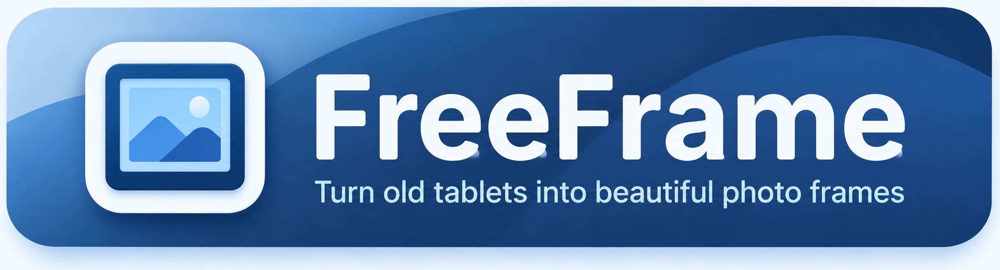
</p>

FreeFrame turns an old Android tablet, such as a Fire tablet sitting in a drawer, into a
photo frame with a family calendar. Everything runs on the tablet itself: it shows the
slideshow, stores the photos and serves a small web page. Anyone on your Wi-Fi can open that
page on a phone or computer to add or remove photos. You need no server, no account and no
cloud. Your photos never leave your home network. There's also a **3D-printable case** for the
Fire 7 that stands it on a desk like a picture frame.

<p align="center">
  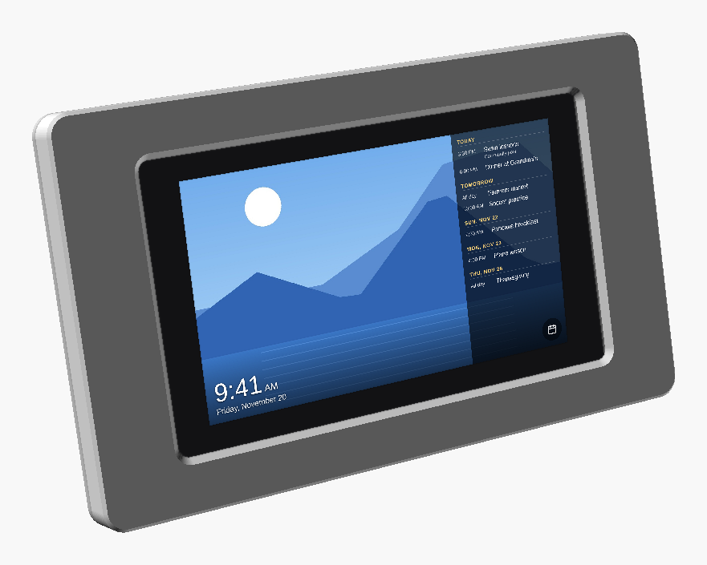
</p>

<p align="center">
  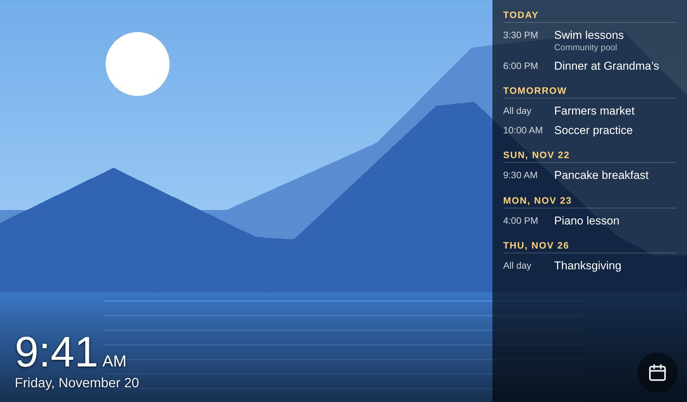
</p>

<sub>Pictures here are illustrations and renders with demo content.</sub>

## Features

- **Slideshow** of photos and silent videos, with a soft crossfade. A video plays to the end,
  then the show moves on.
- **Live Photos and Android motion photos** play their short clip once, then hold the still.
- **Calendar** from any iCal / ICS link (Cozi, Google, iCloud, Outlook). One tap on the frame
  shows or hides it.
- **Clock and date**, which you can turn off.
- **Photo manager in the browser**: add photos and videos from any phone or computer, delete,
  download, and pick what shows next.
- **Formats handled on the tablet**: iPhone and Samsung **HEIC** photos become JPEGs, and
  **HEVC / "High Efficiency"** videos become H.264. The tablet's own video chip does both.
- **4K and HDR videos** are shrunk by the uploading phone's browser before they're sent, so old
  tablets can play them.
- **Duplicate check**: doubles are always added, with a warning. *Find doubles* shows
  look-alikes side by side so you choose what to keep.
- **Night dimming** between set hours, a brightness slider in the manager, and an optional SD
  card for storage.
- **Survives the real world**: resumable uploads over flaky Wi-Fi, starts at boot, comes back
  after updates, and keeps Wi-Fi awake.

<p align="center">
  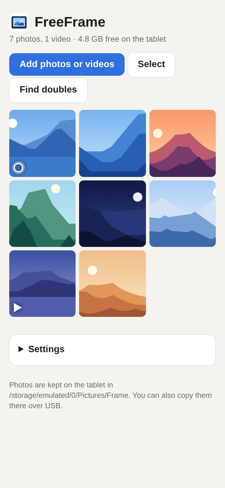
  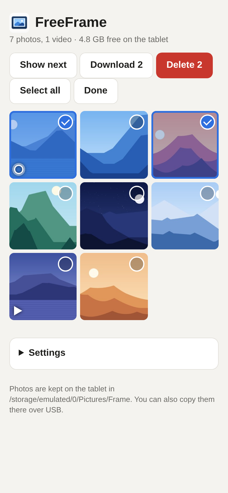
  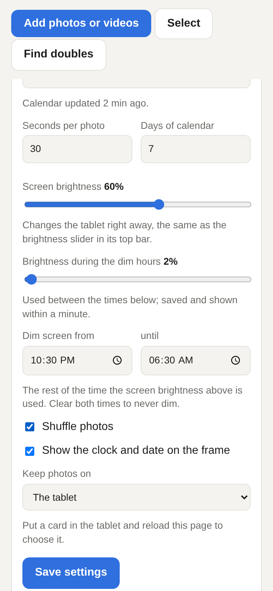
</p>

## What you need

- An Android tablet running **Android 5.1 up to 13**. FreeFrame was built on and tested with a
  **Fire 7 (2017, Fire OS 5)**. Other tablets should work but haven't been tried.
- A Wi-Fi network shared by the tablet and the phones or computers that add photos.
- A charger: the frame keeps the screen on.

Android 14 and newer refuse apps made for Android 5 unless installed with
`adb install --bypass-low-target-sdk-block`.

## Install

Download `FreeFrame-<version>.apk` from the [Releases](../../releases) page, then use either way below.

**With a computer (adb):**

1. On the tablet, turn on USB debugging. On a Fire: *Settings → Device Options*, tap
   *Serial Number* seven times, then *Developer Options → Enable ADB*. On plain Android:
   tap *Build number* seven times, then *Developer options → USB debugging*.
2. Plug it in and run `tools/install.sh FreeFrame-<version>.apk`. That installs the app and
   turns on the always-on settings. Or just `adb install -r FreeFrame-<version>.apk`.

**Without a computer:** copy the APK onto the tablet, allow *Apps from Unknown Sources*
(*Settings → Security*), open the APK in a file manager and install it. Then open **FreeFrame**.

## Using it

1. **Find the address.** Tap a top corner of the frame. A card shows the photo manager's
   address, for example `http://192.168.1.50:8080/`, and it stays right even if your router
   gives the tablet a new one.
2. **Add photos.** Open that address on a phone or computer on the same Wi-Fi and tap *Add photos or
   videos*, or drag files onto the page on a computer. New photos appear on the frame within
   about 20 seconds.
3. **Add your calendar.** Under *Settings*, paste a private iCal (`.ics`) link. Cozi, Google,
   iCloud and Outlook all offer one in their calendar-sharing settings. In Google it's
   *Settings for my calendars → Integrate calendar → Secret address in iCal format*. The
   calendar button at the bottom right of the frame shows or hides it.
4. **Choose what shows next.** Tap *Select*, pick photos and press *Show next*. They come up
   after the current one, in the order you tapped them.

<p align="center">
  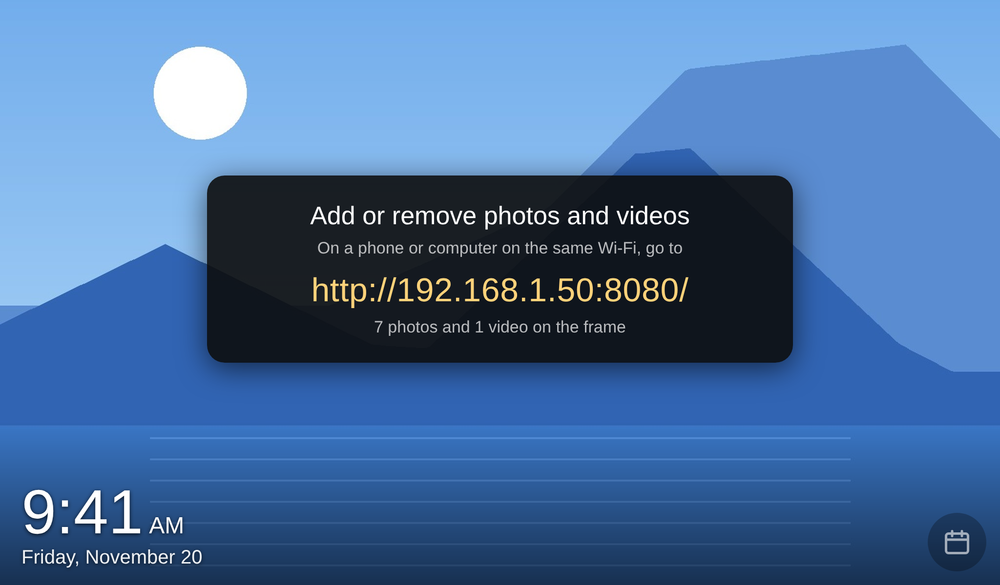
</p>

### Photos and videos from phones

| From | What happens |
| --- | --- |
| JPEG, PNG, WebP | Shrunk to 2048 px by the browser, then stored |
| GIF | Stored as is |
| iPhone / Samsung **HEIC** | Converted to JPEG, by the browser if it can, otherwise by the tablet (a second or two each) |
| H.264 / VP8 / VP9 video up to 1080p | Stored as is, played silently |
| **HEVC** ("High Efficiency") video up to 1080p | Converted to H.264 on the tablet after upload |
| **4K** or **10-bit HDR** video | A smaller H.264 copy is made in the uploading browser first. Keep the page open meanwhile |
| iPhone Live Photo (photo + .MOV picked together), Android motion photo | Still plus a one-time clip on the frame |

If a video can't be used, the manager explains which camera setting makes future videos work
(for example iPhone *Formats → Most Compatible*, or Samsung *High efficiency videos* and
*HDR10+* off).

## Looking after a mounted tablet

`tools/adb-wifi.sh enable` (tablet on USB) switches ADB to Wi-Fi, so you can update the app and
read logs with the cable out. `FRAME_IP=<address> tools/adb-wifi.sh connect` reconnects later.
Fire OS turns this off at every restart, and it can't be made permanent without root.

`http://<tablet>:8080/api/debug` shows the app's version, memory, storage and recent log in any
browser, even when ADB is off. The calendar link is masked there.

## The case

`case/` holds a three-part case for the **Fire 7 (2017, 7th generation)**. It turns the tablet
into a desk frame leaning back 15°. The parts snap together without screws or glue and print
flat with no supports.

<p align="center">
  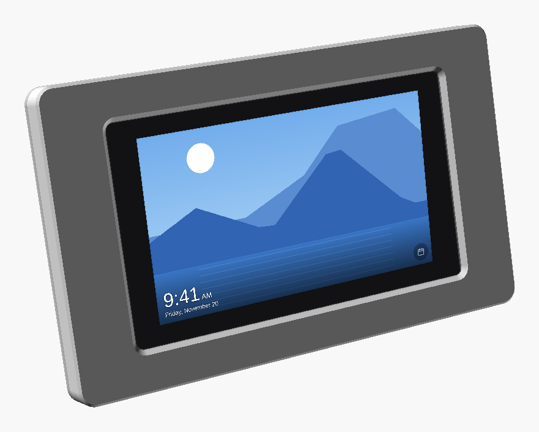
  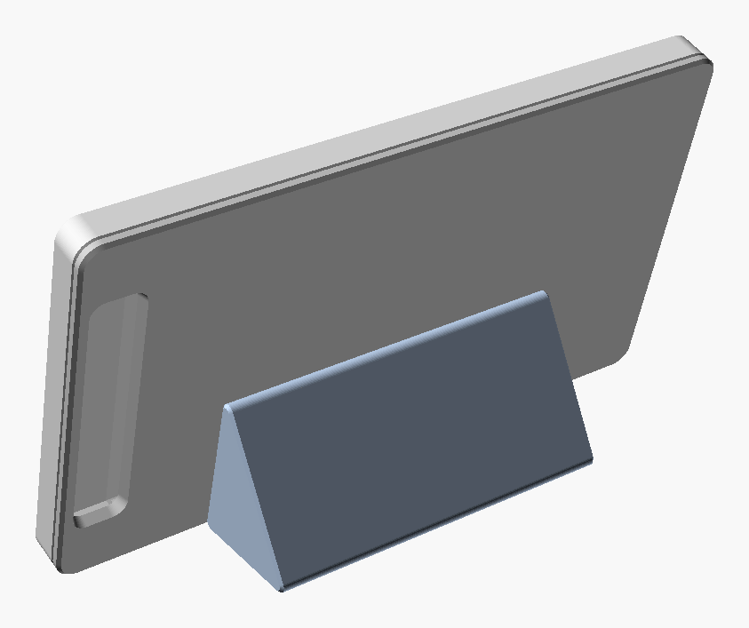
  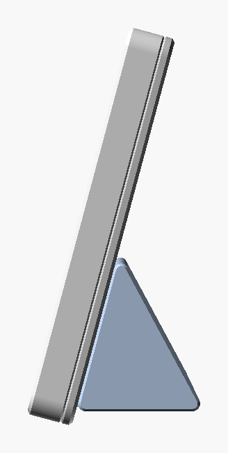
</p>
<p align="center">
  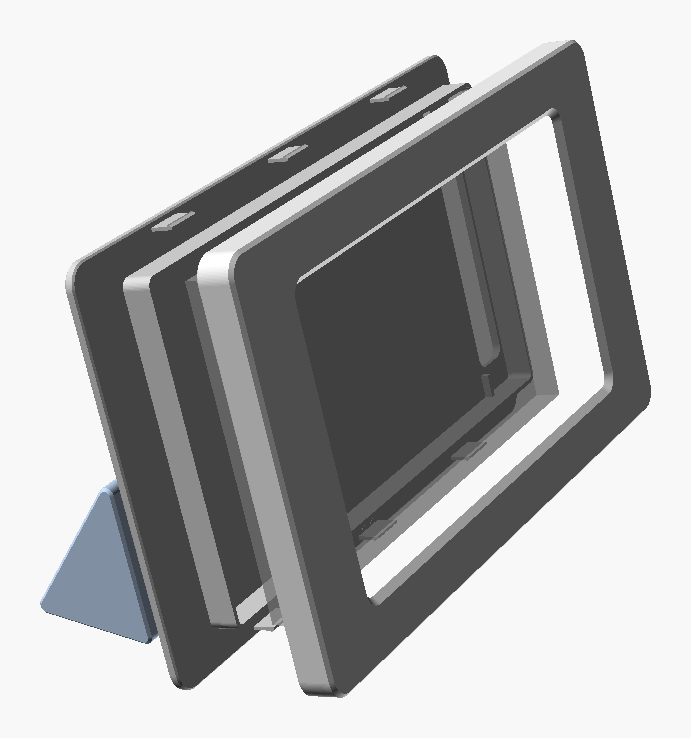
  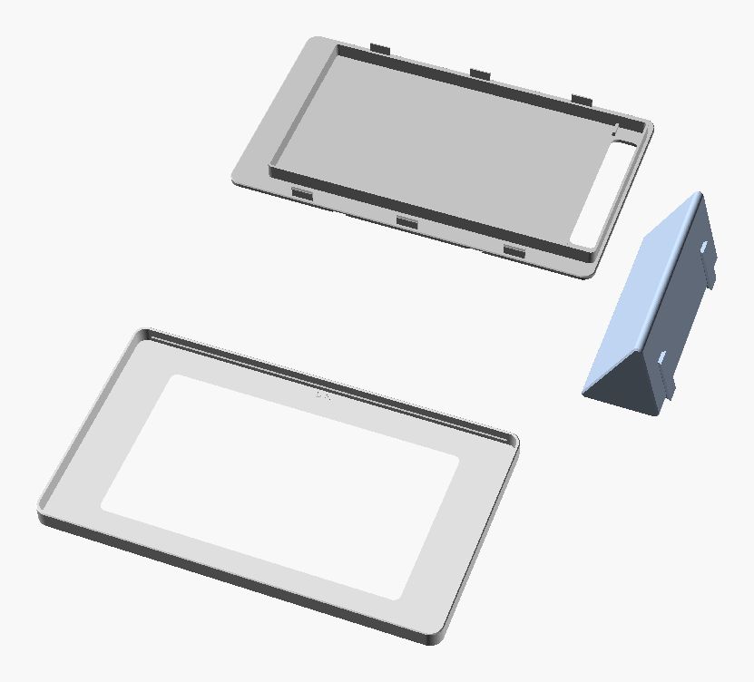
</p>

| Part | File | Print | Size (mm) |
| --- | --- | --- | --- |
| Front bezel | `case/stl/freeframe-case-bezel.stl` | front face down | 241 × 143 × 13 |
| Back tray | `case/stl/freeframe-case-tray.stl` | back face down | 241 × 143 × 14 |
| Stand | `case/stl/freeframe-case-stand.stl` | as it sits, on its desk face | 130 × 50 × 57 |

- **Printer:** a bed of at least 245 × 145 mm. Bezel and stand fit together on a
  250 × 220 bed; the tray goes on its own plate.
- **Settings:** PLA, 0.2 mm layers, no supports.
- **Assembly:** lay the tablet in the tray with its charging port in the pocket at the end, press
  the bezel on until the six clips click, then slide the stand's two rails up into the grooves on
  the back.
- **Cable:** the pocket is sized for a **right-angle micro-USB plug** whose cable runs along the
  tablet's edge or toward the back. It leaves through the opening at the back, which also gives
  access to the power and volume buttons. A straight plug doesn't fit.
- **Tested:** printed and in use on a Fire 7 (2017). If your printer or filament runs tight or
  loose, `freeframe-case-bezel_test.stl` and `freeframe-case-tray_test.stl` are just the port end
  of each part (about 60 g in all), to check the clips, the pocket and the tablet's fit first.
- **Changing it:** `case/freeframe-case.scad` is the OpenSCAD source, with tablet size, fit
  clearances, lean angle, which side the port is on (`port_side`) and stand size at the top. To
  export a part, change the last line from `assembly();` to `bezel_print();`, `tray_print();`,
  `stand_print();`, `bezel_test_print();` or `tray_test_print();` and export to STL.

## Building from source

No Gradle or Android Studio needed: just a JDK and two pieces of the Android SDK.

- **JDK** 17 or newer
- **Android SDK build-tools 36** (`d8`, `aapt2`, `zipalign`, `apksigner`)
- **Android 5.1 platform** (`platforms/android-22/android.jar`)

```sh
sdkmanager "build-tools;36.0.0" "platforms;android-22"
tools/build-apk.sh                        # makes build/FreeFrame.apk
tools/install.sh                          # puts it on a plugged-in tablet
```

`BUILD_TOOLS`, `ANDROID_JAR` or `ANDROID_HOME` point the script at another SDK. The first build
makes a signing key, `freeframe.keystore` (password `freeframe`, or set `KEYSTORE_PASS`). **Keep
that file and don't commit it.** Updates must be signed with the same key, or Android refuses to
install them over the old version.

## How it works

```
app/src/local/photoframe/
  MainActivity    full-screen web view showing the frame; keeps the screen on, comes back to the front
  FrameService    runs the web server on port 8080 and holds a Wi-Fi lock
  HttpServer      a small HTTP/1.1 server: ranges for video, uploads in resumable pieces
  FrameApi        the API: photos, uploads, settings, calendar, "show next", duplicates, debug
  Photos          storage (internal or SD), thumbnails and screen-sized copies, fingerprints
  Ical            reads the calendar feed and expands repeating events
  Heic            HEIC to JPEG: reads the HEIF boxes, decodes tiles on the HEVC chip, joins them in OpenGL
  Transcoder      HEVC to H.264 on the tablet's hardware decoder and encoder
  Fmp4            rewraps the fragmented MP4 that browsers record into plain MP4
app/assets/
  frame.html      the slideshow, clock and calendar the tablet shows
  manage.html     the photo manager for phones and computers
```

Photos live in `Pictures/Frame` on the tablet (or on the SD card), so you can also copy them over
USB. Settings stay on the tablet across updates.

## Known limits

- **Fire OS without root.** Amazon's apps can't be removed, and the lock screen appears after a
  restart (one swipe, then the frame starts by itself).
- **Old hardware.** Fire 7 (2017) chips decode video up to 1080p and only 8-bit HEVC. Larger
  videos rely on the uploading browser to make a smaller copy.
- **Same network.** The manager is reachable only on your own Wi-Fi.
- **SD card storage** is built in, but hasn't been tried with a real card yet.

## License

[MIT](LICENSE), for the app and the case alike: use it, change it, print it, sell it or share
it. Just keep the licence note with copies of the code.
